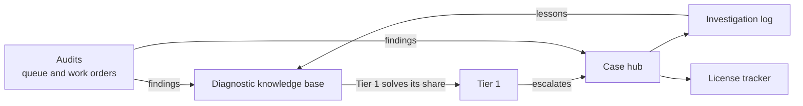

# Portfolio — Technical Operations, Process Automation and Data

**Herbert Marques** · Technical Support Supervisor

These are tools and analyses I designed to make technical support more traceable, faster and less dependent on people's memory. Each page explains the problem, the solution, the design decisions and what I learned.

> Company tools are internal, so these pages describe the problem and the design. They contain no source code, customer data, internal figures or names.
> Projects marked **code** have public source code with fictitious data.

## Projects

| # | Project | What it is | Stack |
| --- | --- | --- | --- |
| 1 | [Tier 2 Case Hub](projects/01-case-hub.md) | Web app: case ownership, blockers, follow-ups, daily snapshots, audit trail | Apps Script · Sheets |
| 2 | [Technical Investigation Log](projects/02-investigation-log.md) | Guided form + automatic evidence filing | Apps Script · Forms · Drive |
| 3 | [Diagnostic Knowledge Base](projects/03-diagnostic-knowledge-base.md) | Diagnostic decision trees split by complexity level | Technical documentation |
| 4 | [Support Queue Audit](projects/04-support-queue-audit.md) | Tier 1 → Tier 2 handoff analysis with SQL and AI | BigQuery · AI |
| 5 | [Supplier License Reset Tracker](projects/05-license-reset-tracker.md) | Internal vs supplier time on license requests | Apps Script · Sheets |
| 6 | [Field Service Evidence Audit](projects/06-field-service-evidence-audit.md) | Checks work orders closed without the required proof | BigQuery · Sheets |
| 7 | [Personal Task App](projects/07-personal-task-app.md) | Lightweight task manager with postpone counter | Apps Script · Sheets |
| 8 | [Personal Learning Platform](projects/08-learning-platform.md) | Multi-user study platform with AI feedback | Apps Script · Gemini API |
| 9 | [Operations Intelligence](https://github.com/herbert5467-blip/operations-intelligence) **code** | Support KPIs with SQL on a fictitious dataset | Python · BigQuery |

## How the support projects fit together

The audits show where the process breaks. The knowledge base and the investigation log fix the knowledge. The case hub makes sure no case is left without an owner.

## How I work

- **Evidence before opinion.** When the data cannot answer, I say so.
- **Each level in its role.** Tier 2 is not "a Tier 1 who knows more".
- **A simple tool the team uses beats a perfect system nobody opens.**
- **AI as a builder's tool.** I use AI to build faster; I define the problem, the rules and the acceptance criteria, and I check the result.

## Currently learning

SQL (BigQuery), Python, Git, REST APIs, workflow automation (n8n, Power Automate) and AI agents, on a 24-week plan. New public projects will be added here as they are finished.
