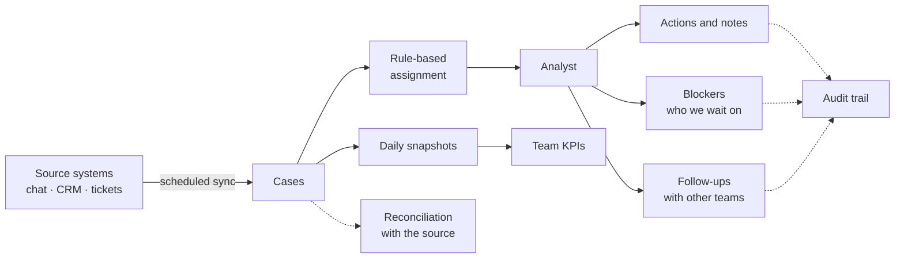

# Tier 2 Case Hub

> An internal web app that gives every Tier 2 support case an owner, a visible blocker, a follow-up date and a full history.
>
> **Type:** internal tool · **Stack:** Google Apps Script, Google Sheets, HTML Service · **My role:** idea, business rules, build and rollout

## The problem

Tier 2 cases started in different systems (chat, CRM and field-service tickets). There was no single place to answer simple questions:

- Who owns this case right now?
- What is blocking it, and who are we waiting on?
- Did we ask another team for something? Did they answer?
- Is the same customer opening several conversations about the same issue?

Follow-ups depended on each analyst's memory, and supervisors only saw a problem once it had become a complaint.

## The solution

A web app that uses a spreadsheet as a transactional database, with one table per entity.

| Module | What it does |
| --- | --- |
| Sync | Imports and updates cases from the source systems on a schedule, logging new, updated, closed and reopened cases |
| Assignment | Assigns each case by rule and records why that analyst was chosen |
| Actions | Logs every step with type, next action and due date |
| Blockers | Shows what is blocking a case, which team it depends on and since when |
| Follow-ups | Tracks requests to other teams and when to check again |
| Duplicates | Flags the same customer with several open conversations about the same contract |
| Daily snapshots | Stores the state of every case each day, so trends can be analysed over time |
| KPIs | Brings CSAT, first-contact resolution and quality scores together by analyst |
| Reconciliation | Compares the hub's numbers with the source and records the reason for each gap |
| Audit trail | Records every change: user, field, old value, new value |
| Permissions | Analyst, supervisor and admin roles |

## Design decisions

- **Personal data is masked** in the database (privacy by design).
- **Nothing is deleted.** Notes are voided with a reason, never removed.
- **Version control per record**, so two people cannot overwrite the same case.
- **Rules live in a settings table**, not in the code, so the team can change deadlines without a developer.

## What I learned

- A spreadsheet can work as a database if you are strict about unique keys, record versions and logging.
- Syncing with external systems needs reconciliation, or nobody trusts the numbers.
- For a supervisor, the daily history is worth more than today's open cases.

> The code and data are internal and not published. This page describes the problem, the design and the decisions.
