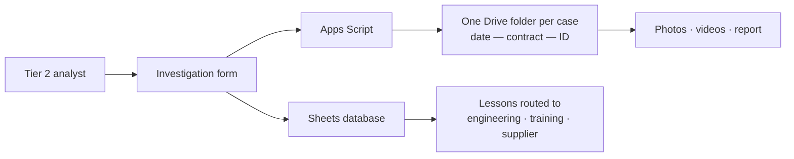

# Technical Investigation Log

> A guided form that turns every Tier 2 technical investigation into a structured record, with evidence filed automatically.
>
> **Type:** internal tool · **Stack:** Google Forms, Google Sheets, Google Apps Script, Google Drive · **My role:** idea and build. It became the reference architecture for my other Apps Script tools.

## The problem

Technical diagnosis happened in chat, often through audio, video and photos. When the case closed, the knowledge left with it:

- Nobody could tell what had been tested or what the likely cause was.
- Nobody could tell whether the same problem had happened before on that machine.
- Photos, videos and reports were scattered and not linked to the case.

## The solution

| Section | What the analyst records |
| --- | --- |
| Identification | Ticket, serial number, equipment line, time since installation |
| Escalation | Why it was escalated, whether Tier 1 could have solved it, whether the playbook helped |
| Investigation | Observed facts, component, defect type, tests run, likely origin, hypothesis |
| Resolution | What was done, result, parts sent |
| Evidence | Links to photos, video, audio and technical report |
| Feedback | Main finding, which team should receive it, recommended action |

Each record gets a unique ID and its own Drive folder, with files renamed to the same pattern.

## Why it matters

- A closed case becomes **training material**, not just a finished chat.
- "Could Tier 1 have solved this?" feeds the [diagnostic knowledge base](03-diagnostic-knowledge-base.md).
- "Which team should learn from this?" connects support to engineering, training and suppliers.

## What I learned

- A well-designed form is a thinking tool: it forces you to separate **fact**, **hypothesis** and **action**.
- Consistent file and folder names solve half of the evidence problem.

> The code and data are internal and not published.
