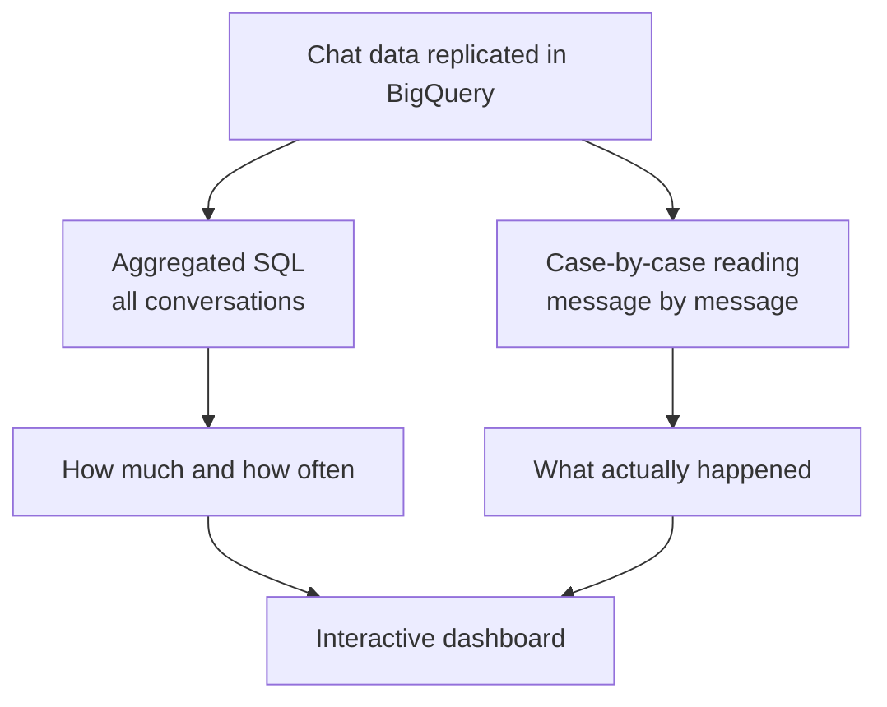

# Support Queue Audit (Tier 1 → Tier 2)

> An evidence-based analysis of how support conversations move from Tier 1 to Tier 2, using SQL on BigQuery plus AI-assisted reading of conversations, delivered as an interactive dashboard.
>
> **Type:** data analysis · **Stack:** BigQuery (SQL), AI-assisted analysis, web dashboard · **My role:** defined the questions, the criteria and the analysis rules; validated the findings

## The questions

The goal was **not** to measure individual productivity. It was to answer five questions:

1. What does Tier 1 receive, solve and escalate, and are escalations justified?
2. Did Tier 1 follow the support material before escalating?
3. Did Tier 1 hand over enough information for Tier 2 to act without rework?
4. Did Tier 2 investigate the root cause, or just close the conversation?
5. Was the customer's problem solved, or did it only leave the queue?

**Working rule:** never assume. When the data cannot answer, write "could not be determined".

## Method

SQL shows volume and frequency. Reading the conversations shows whether an escalation was fair and who actually solved the problem. You need both.

## What it found (patterns, not figures)

- **A few recurring causes** concentrated a large share of the volume.
- **Handoffs without context:** the field meant to tell Tier 2 what had already been tried was usually empty.
- **Diagnosis without a record:** when troubleshooting happened by audio or video, nobody could later tell who solved the problem.
- **A broken metric:** the waiting-time field held values longer than the whole conversation, so any SLA built on it was wrong.
- **No evidence of a technical knowledge gap** in the cases read. The problems were in process and documentation.

## Recommendations delivered

A handoff note template, a written summary at the end of every diagnosis, proactive communication of supplier deadlines, and a fix for the waiting-time metric.

## What I learned

- AI speeds up reading hundreds of conversations, but the manager defines the questions and what "justified" means.
- A number is only reliable when you know exactly what it measures. Two different volume figures can both be right if they count different things.
