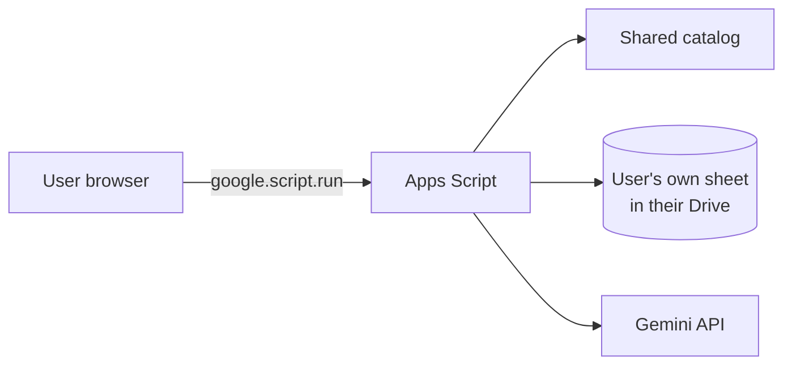

# Personal Learning Platform

> A study platform I use every day for my learning path in data, automation and AI: lessons, exercises, spaced-repetition cards, habit tracking and a 24-week career plan.
>
> **Type:** personal project · **Stack:** Google Apps Script web app, Google Sheets, Gemini API · **My role:** requirements and design; built with AI assistance

## The problem

Online courses are generic. I wanted a path built around my real work, that turns study into practice and keeps me consistent.

## The solution

- **Multi-user:** runs as the visiting Google account, and each person's progress is stored in a spreadsheet in their own Drive. Nobody sees anyone else's data.
- **Shared catalog + personal overlay:** modules and lessons live in one catalog; each user's progress is merged on top.
- **Lessons with checklist exercises**, hints and answer keys; answers are saved and can be corrected by AI.
- **Spaced-repetition review cards**, habit check-ins and a "one thing" focus for the day.
- **Server-side AI:** the Gemini API key stays in script properties and never reaches the browser.

## What I learned

- Executing as the visiting user is the simplest way to keep each person's data private.
- Google OAuth scopes and Drive storage limits matter as much as the code when you ship to other people.
